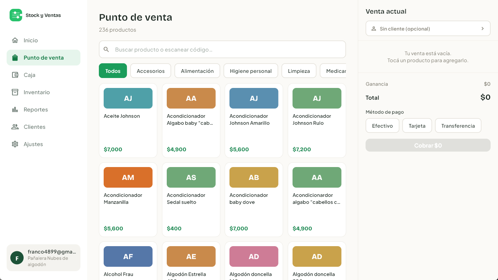
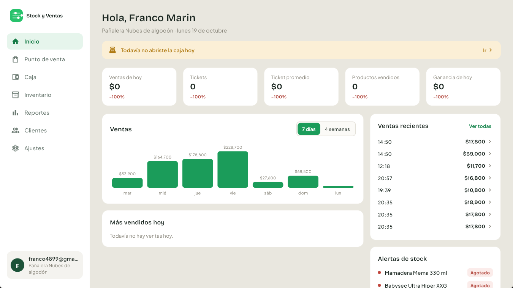
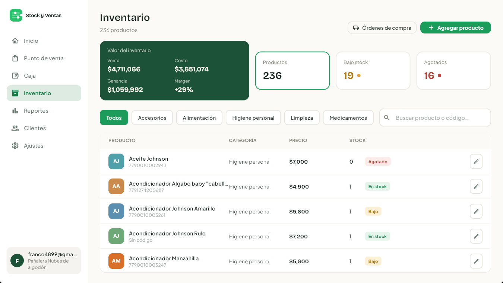
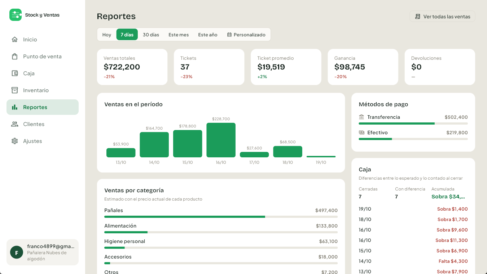
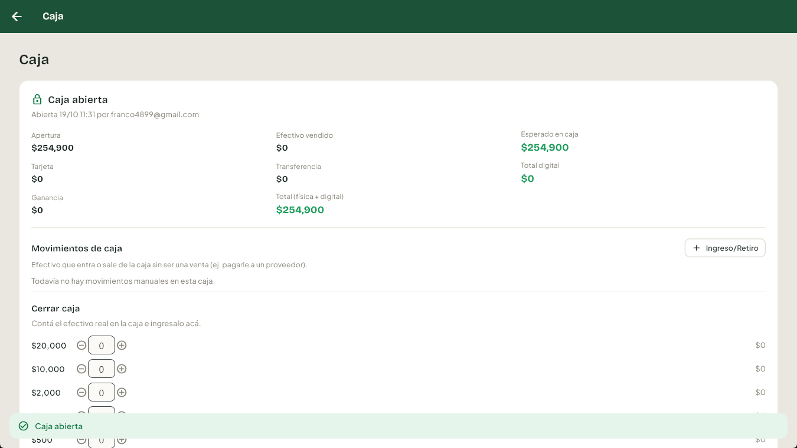
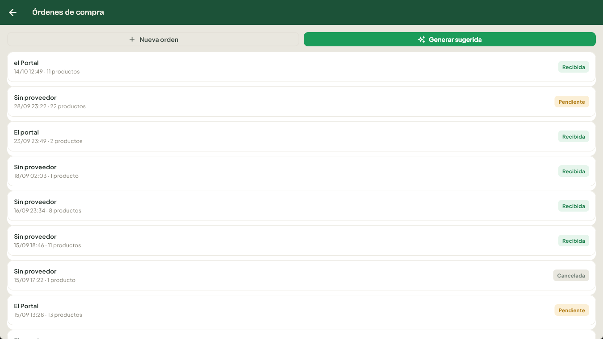
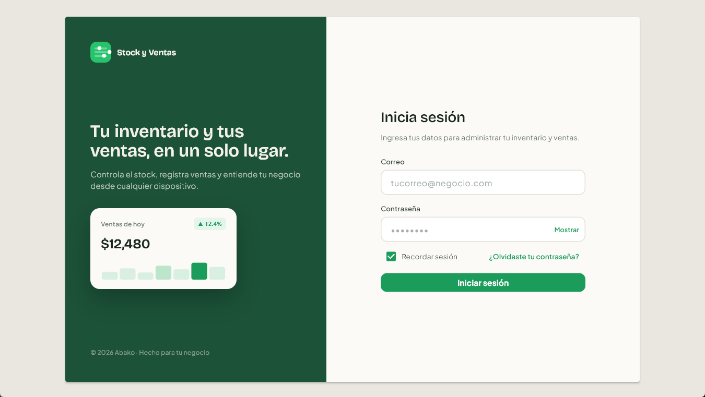
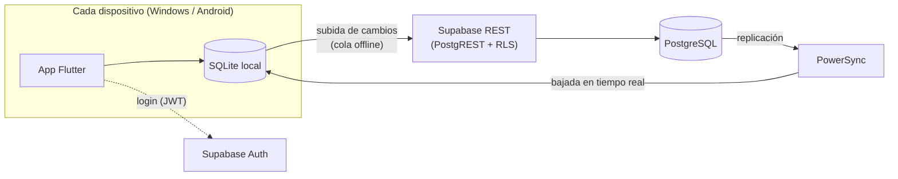

# Abako — Ventas y stock offline-first

Sistema de punto de venta y control de stock para comercios chicos. Corre en **Windows y Android** con un solo código y **sigue funcionando sin internet**: las ventas se guardan en el dispositivo y se sincronizan solas cuando vuelve la conexión.

**Está en uso real** en una pañalera de Tucumán, con un catálogo de ~236 productos, ventas diarias, control de caja y pedidos a proveedores.



---

## Qué hace

- **Punto de venta**: carrito con varios productos, búsqueda o escaneo de código de barras (lector USB en PC o cámara del celular) y cobro con pagos combinados (efectivo, tarjeta, transferencia).
- **Inventario**: alta, edición y baja de productos, categorías, stock mínimo con alertas de *bajo stock* y *agotado*, y valor del inventario a precio de venta y de costo.
- **Caja**: apertura y cierre diario con conteo por billete, ingresos y retiros manuales, y diferencia entre lo esperado y lo contado.
- **Órdenes de compra**: manuales o **sugeridas automáticamente** según el stock mínimo, con el importe a pagar al proveedor. Al recibirlas, el stock se suma solo.
- **Reportes**: ventas por período, ticket promedio, ganancia, ventas por categoría, métodos de pago e historial de cierres de caja.
- **Devoluciones, historial de ventas y clientes**.
- **Usuarios**: login por email, recuperación de contraseña, alta de usuarios por invitación y bloqueo biométrico al abrir la app.

## Capturas

| Inicio | Inventario |
|---|---|
|  |  |
| **Reportes** | **Caja** |
|  |  |
| **Órdenes de compra** | **Login** |
|  |  |

## Arquitectura



- La app **siempre lee y escribe en una base SQLite local**, por eso responde al instante y no depende de la conexión.
- **PowerSync** replica los datos de Postgres en cada dispositivo y mantiene una cola de cambios pendientes de subir.
- Los cambios suben a **Supabase** con el token del usuario logueado, y las políticas **RLS** de Postgres deciden qué puede hacer cada uno.

## Decisiones técnicas

### El stock no se guarda: se calcula

El problema central de un sistema offline con varios dispositivos es que dos de ellos modifiquen el mismo dato sin estar conectados. Si el stock fuera un campo `cantidad` que cada venta pisa con un `UPDATE`, dos ventas offline simultáneas harían que una sobrescriba a la otra, y se perdería stock.

Por eso la tabla `movimientos_stock` es **append-only**: cada venta, compra, ajuste o devolución **inserta** un movimiento (`+10`, `-1`, `-3`...) que nunca se modifica ni se borra. El stock actual es la **suma** de los movimientos. Como la suma es conmutativa, no importa en qué orden lleguen los cambios de cada dispositivo: el resultado final siempre es el mismo.

La regla está reforzada **en la base de datos**, no solo en la app: las políticas RLS de esa tabla permiten `SELECT` e `INSERT`, pero no `UPDATE` ni `DELETE`.

### Ventas sin stock: se detectan, no se bloquean

Dos cajeros sin conexión pueden vender la última unidad al mismo tiempo. Bloquear la venta es imposible, porque ninguno sabe lo que hizo el otro. Rechazarla después sería peor: el cliente ya se llevó el producto.

En su lugar, un **trigger de Postgres** (`supabase/migrations/03_sobregiro_trigger.sql`) recalcula el stock cuando llega cada venta y, si quedó negativo, la marca como `pendiente_revision`. La app muestra un aviso en el inicio para que una persona revise el caso. Hay un test en SQL que reproduce el escenario (`supabase/tests/sobregiro_test.sql`).

### Subidas idempotentes

Con conexiones inestables, una misma operación puede reintentarse después de haber llegado al servidor. Al principio eso generaba un error `409 duplicate key` que **trababa toda la cola de sincronización**. Lo resolví tratando el `409` de un `INSERT` como "ya aplicado". No usé *upsert* porque requiere permiso de `UPDATE`, que las tablas append-only no tienen a propósito.

### Precios congelados en el tiempo

Las ventas y las órdenes de compra guardan el precio o el costo **del momento**. Así, un ticket viejo o el importe de una orden no cambian si después se actualiza el precio de un producto.

## Tecnologías

| Capa | Tecnología |
|---|---|
| App (Windows + Android) | Flutter / Dart |
| Base local y sincronización | PowerSync (SQLite) |
| Backend | Supabase: PostgreSQL, Auth, REST, Edge Functions |
| Seguridad | Row Level Security de Postgres + JWT |
| Otros | `mobile_scanner` (códigos de barras), `local_auth` (biometría) |

## Estructura del repo

```
lib/
  screens/        pantallas (punto de venta, inventario, caja, reportes...)
  connector.dart  subida de cambios de PowerSync a Supabase
  schema.dart     esquema de la base local
supabase/
  migrations/     scripts SQL en orden: tablas, políticas RLS y triggers
  functions/      Edge Functions (alta y baja de usuarios)
  tests/          test del trigger de sobregiro
docs/screenshots/
```

## Cómo correrlo

1. Crear un proyecto en [Supabase](https://supabase.com) y correr en orden los scripts de `supabase/migrations/` en el SQL Editor.
2. Crear una instancia de [PowerSync](https://www.powersync.com) conectada a ese Postgres, con autenticación de Supabase.
3. Copiar `lib/powersync_config.example.dart` como `lib/powersync_config.dart` y completar las URLs y la clave pública.
4. Ejecutar:

```bash
flutter pub get
flutter run -d windows   # o un dispositivo Android
```

Es una app interna, sin registro público: los usuarios se crean desde el panel de Supabase o se invitan desde Ajustes.

## Próximas mejoras

- Recepción parcial de órdenes de compra.
- Notificaciones push (bajo stock, ventas para revisar, caja sin cerrar).
- Roles de usuario (administrador / vendedor).
- Integración con impresora fiscal.
- Instalador para Windows y publicación de la app Android.
- Tests automatizados de la app.

---

Desarrollado por **Franco Emmanuel Marin**.
